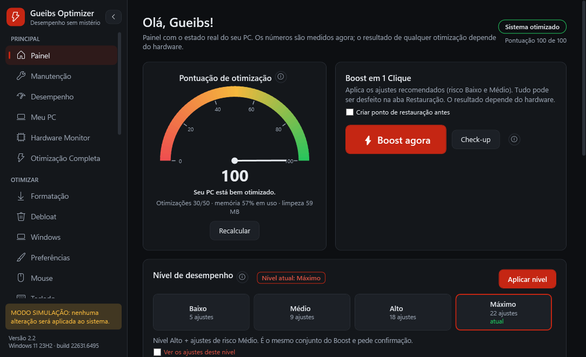
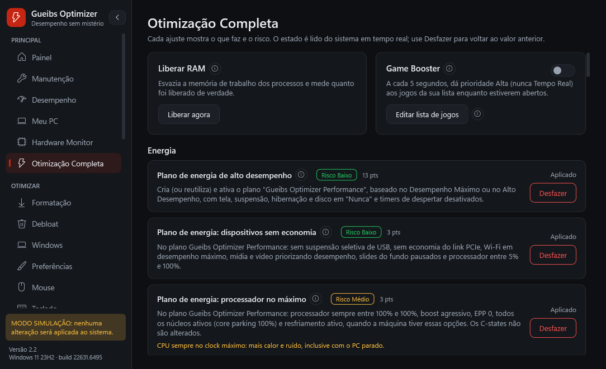
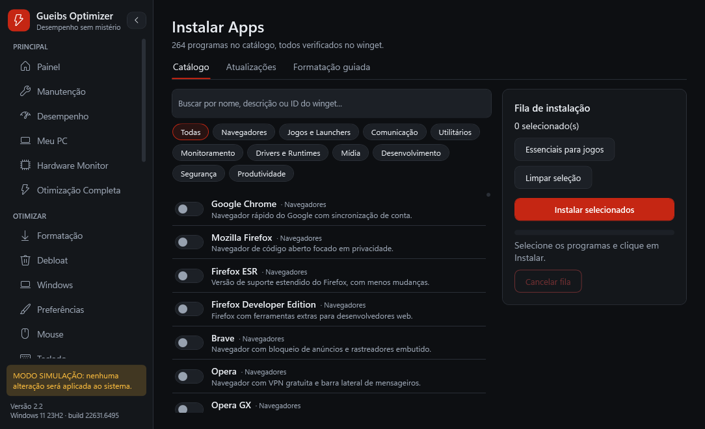
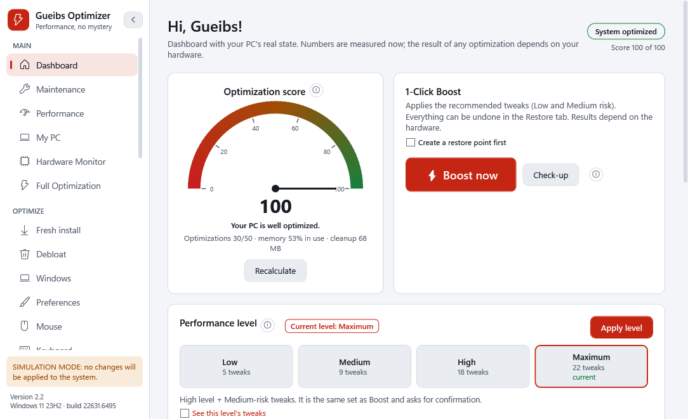

<div align="center">


# Gueibs Optimizer

**Otimizador de PC gamer para Windows 10/11, com desfazer para cada ajuste e modo simulação.**

[](https://github.com/Gueibsz/GueibsOptimizer/releases/latest)
[](https://github.com/Gueibsz/GueibsOptimizer/actions/workflows/ci.yml)
[](LICENSE)


[Download](#-download) · [Recursos](#-recursos) · [Capturas](#%EF%B8%8F-capturas-de-tela) · [Como o desfazer funciona](#%EF%B8%8F-como-o-desfazer-funciona) · [Compilar](#%EF%B8%8F-compilar-a-partir-do-código) · [English](#-english)



</div>

> [!WARNING]
> **Este programa altera o Windows**: registro, serviços, tarefas agendadas, plano de energia, apps instalados e configurações de rede. Todo ajuste guarda o valor anterior e pode ser desfeito, mas **o uso é por sua conta e risco**, sem garantia de nenhum tipo (veja a [LICENSE](LICENSE)). Antes de usar, crie um ponto de restauração (o app oferece isso) e, se quiser ver tudo sem mudar nada, abra com `--dry-run`.

## ✨ Por que este otimizador

- **Tudo é reversível.** Cada ajuste salva o valor original (com o tipo do registro) antes de mudar, e tem botão **Desfazer**.
- **Nada de promessas.** A pontuação é lida do estado real do sistema e os números mostrados são medidos. O ganho de FPS depende do seu hardware.
- **Seguro com anti-cheat.** Sem injeção de DLL, sem hooks gráficos e sem ler a memória de jogos. O FPS vem só de eventos ETW via PresentMon.
- **Sem desligar a sua proteção.** O Defender, o Firewall e o UAC nunca são desligados.
- **Transparente.** Cada ajuste mostra o que muda, o risco (Baixo, Médio ou Alto) e como desfazer, no botão **i** do cartão.
- **Sem telemetria própria** e sem downloads de fontes desconhecidas: só winget ou páginas oficiais.

## 📥 Download

1. Baixe o **`GueibsOptimizer-Setup-<versão>.exe`** na página de [Releases](https://github.com/Gueibsz/GueibsOptimizer/releases/latest).
2. Execute o instalador. Ele pede permissão de administrador, porque o app precisa dela para alterar o Windows.
3. Abra o **Gueibs Optimizer** pelo menu Iniciar.

**Requisitos:** Windows 10 (2004 ou mais novo) ou Windows 11, **x64**, conta de administrador. Para instalar programas pelo catálogo, o **winget** (Instalador de Aplicativo da Microsoft Store).

> [!NOTE]
> O instalador **não tem assinatura de código** (o certificado é pago). Na primeira execução, o SmartScreen mostra "O Windows protegeu o computador": clique em **Mais informações → Executar assim mesmo**. Alguns antivírus podem acusar um **falso positivo**, comum em otimizadores porque eles alteram registro e serviços. Para conferir o arquivo, compare o SHA-256 com o `.sha256` publicado no release:
>
> ```powershell
> Get-FileHash .\GueibsOptimizer-Setup-2.2.1.exe -Algorithm SHA256
> ```
>
> Se preferir, compile você mesmo (veja abaixo).

## 🚀 Recursos

| Área | O que tem |
|---|---|
| **Painel** | Pontuação de 0 a 100 lida do sistema, **Boost em 1 clique** com resumo "antes → depois" medido, níveis Baixo/Médio/Alto/Máximo, cartões de RAM, CPU, limpeza e pontos de restauração |
| **Otimizações** | Plano de energia, Modo de Jogo, GPU (HAGS, Game DVR), mouse e teclado, privacidade e IA (telemetria, Copilot, Recall, anúncios), preferências do Explorer, DNS, recursos opcionais e modos seguros do Windows Update |
| **Windows** | Limpeza com prévia do tamanho, inicialização limpa (desativa sem apagar), manutenção (CHKDSK em leitura, DISM, SFC), correções de rede, Windows Update, Store e cache de ícones |
| **Debloat** | Remoção dos apps da Store que você marcar, com lista de protegidos que nunca entram e predefinições Leve/Equilibrado/Agressivo |
| **Ferramentas** | Overlay de FPS e 1% low sem injeção, ping e teste de velocidade, polling rate do mouse (Raw Input), teste do monitor (UFO, ghosting), Hardware Monitor e Check-up (dual channel, XMP/EXPO, PCIe) |
| **Meu PC** | Processador, caches, placa-mãe, slots de memória, GPU e discos, com diagrama e exportação em .txt, .html e .json (sem números de série por padrão) |
| **Meus Jogos** | Detecção de jogos da Steam, Epic e outros launchers, GPU de alto desempenho e prioridade por jogo e presets gráficos por nível do PC |
| **Instalar Apps** | Catálogo de 264 programas com IDs do winget validados, instalação em fila, atualização em 1 clique e assistente para Windows recém-formatado |
| **Perfis e Restauração** | Perfis `.gopro` validados por schema, histórico de ajustes, desfazer um, desfazer tudo e atalho para o Restaurar Sistema |
| **Interface** | Português do Brasil, inglês e espanhol, temas escuro e claro e cor de destaque personalizável |

## 🖼️ Capturas de tela

<table>
  <tr>
    <td></td>
    <td></td>
  </tr>
  <tr>
    <td align="center">Cada ajuste com o risco, os pontos e o botão Desfazer</td>
    <td align="center">Catálogo de programas instalados pelo winget</td>
  </tr>
  <tr>
    <td colspan="2"></td>
  </tr>
  <tr>
    <td colspan="2" align="center">Tema claro e interface em inglês</td>
  </tr>
</table>

## ↩️ Como o desfazer funciona

1. **Antes de qualquer alteração**, o valor anterior vai para `%AppData%\GueibsOptimizer\backup.json`, com o tipo do registro (DWORD, String, Binário…), se o valor existia e qual chave foi criada pelo app. Reaplicar um ajuste nunca sobrescreve esse original.
2. Estados que não são de registro (plano de energia anterior, tipo de inicialização de serviços, tarefas, DNS, exclusão do Defender, itens de inicialização) ficam no mesmo arquivo.
3. **Desfazer** restaura em ordem inversa: valores que não existiam são apagados, chaves criadas pelo app são removidas se ficarem vazias e os valores voltam com o tipo original.
4. O Boost, os níveis, os perfis, o Debloat e o assistente de formatação podem criar um **ponto de restauração do Windows** antes de começar. Se o Windows recusar (Proteção do Sistema desligada ou limite de 1 ponto a cada 24 h), o app explica e pergunta se deve continuar.
5. O estado de cada ajuste é **lido do sistema**, então a tela mostra a realidade mesmo se algo for desfeito fora do app.
6. **Exceção:** remover apps da Store e desinstalar o OneDrive não são 100% reversíveis. O desfazer reinstala pelo winget ou pela Store quando há um ID confirmado.

## 🧾 Ajustes e riscos

Os ajustes que contam pontos somam 100. Os que não se aplicam à sua versão do Windows (ex.: Recall no Windows 10) saem do total. Ajustes de risco **Médio** ficam fora do Boost salvo indicação, e os de risco **Alto** pedem confirmação dupla.

<details>
<summary><b>Desempenho, jogos e entrada</b></summary>

| Ajuste | O que faz | Risco | Observação |
|---|---|---|---|
| Plano de energia de alto desempenho | Cria e ativa "Gueibs Optimizer Performance" (Desempenho Máximo ou Alto Desempenho), em camadas por nível | Baixo | Mais consumo e calor; em notebook, só na tomada |
| Modo de Jogo e prioridade multimídia | Liga o Modo de Jogo e prioriza a tarefa "Games" do MMCSS | Baixo | |
| HAGS | Agendamento de GPU acelerado por hardware (`HwSchMode=2`) | Médio | Requer reinício |
| Desativar Game DVR | Desliga a gravação em segundo plano da Xbox Game Bar | Baixo | |
| Desativar aceleração do mouse | `MouseSpeed`/`MouseThreshold1/2` = 0 | Baixo | Efeito completo após logoff |
| Repetição de teclado mais rápida | Atraso mínimo e repetição máxima | Baixo | Efeito após logoff |
| Atalhos de acessibilidade | Desliga os atalhos de Teclas de Aderência, Filtro e Alternância | Baixo | Efeito após logoff |
| Game Booster | Prioridade Alta para jogos da lista `games.json` (nunca Tempo Real) | Baixo | Restaura ao fechar o jogo |
| Por jogo: GPU de alto desempenho e prioridade de CPU | `UserGpuPreferences` e `PerfOptions` (IFEO) | Baixo / Médio | Na tela Meus Jogos |
| Desativar ou manter a hibernação | `powercfg /hibernate` | Médio / Baixo | Fora do Boost |

</details>

<details>
<summary><b>Privacidade e IA</b></summary>

| Ajuste | Risco | Observação |
|---|---|---|
| Reduzir telemetria (`AllowTelemetry=0`, sem pedidos de feedback) | Baixo | No Home e no Pro o mínimo efetivo é "Obrigatório" |
| Serviços de telemetria (`DiagTrack`, `dmwappushservice`) | Médio | |
| Tarefas de compatibilidade e CEIP | Baixo | |
| Desativar o Copilot (política e botão da barra) | Baixo | Windows 11 22H2+ |
| Bloquear capturas do Recall (`DisableAIDataAnalysis`) | Baixo | Windows 11 24H2+ |
| Recurso opcional Recall | Médio | Requer reinício |
| Sugestões, anúncios e ID de publicidade | Baixo | |
| Sugestões no Iniciar e na tela de bloqueio, Widgets, Bing na pesquisa | Baixo | Widgets só no Windows 11 |
| Histórico de atividades, recursos para consumidores, telemetria do PowerShell 7 | Baixo | |
| Rastreamento de localização, apps em segundo plano | Médio | Fora do Boost |
| Políticas do Edge (impulso de inicialização, segundo plano, sugestões, dados, barra lateral) | Baixo | Não desinstala o Edge |

</details>

<details>
<summary><b>Windows, rede e aparência</b></summary>

| Ajuste | Risco | Observação |
|---|---|---|
| Serviços pouco usados em Manual (lista fechada em `Data/services-manual.json`) | Médio | Nunca Defender, Firewall, Windows Update, rede ou áudio |
| Sensor de Armazenamento desligado, "Finalizar tarefa" na barra | Baixo | |
| DNS por adaptador (Cloudflare, Google, Quad9, AdGuard ou personalizado) | Baixo | Desfazer volta ao DNS anterior |
| Preferir IPv4 / desativar IPv6 | Médio | Fora do Boost |
| Modos do Windows Update: Padrão, Somente segurança, Pausar até 35 dias | Baixo / Médio | Não existe "desativar de vez" |
| Recursos opcionais (.NET 3.5, Hyper-V, WSL, Sandbox…) | Médio | Hyper-V pode afetar jogos e anti-cheat |
| OneDrive: política de sincronização / desinstalar | Médio / Alto | Desinstalar pede confirmação dupla |
| Efeitos visuais para desempenho, menu de contexto clássico | Baixo | Preferência |
| Relógio do hardware em UTC (dual boot), desativar Intel LMS | Médio | Fora do Boost |
| Preferências do Explorer (extensões, ocultos, NumLock, tema escuro, Snap, barra de tarefas…) | Baixo | Não contam pontos |
| Debloat de apps da Store | Médio a Alto | Protegidos nunca são removidos; não é 100% reversível |
| Exclusão do Defender **só da pasta do app** | Baixo | Opcional, com confirmação |

</details>

A chave exata de cada ajuste aparece no botão **i** de cada cartão e em [`Data/tweaks.json`](GameOptimizer/src/GueibsOptimizer/Data/tweaks.json).

## ⌨️ Opções de linha de comando

| Argumento | O que faz |
|---|---|
| *(nenhum)* | Abre o app normalmente. |
| `--dry-run` | **Modo simulação**: abre a interface, mas nada é alterado. Tudo o que seria feito aparece em *Atividade* e no log. |
| `--report` | Sem janela: grava em `%AppData%\GueibsOptimizer\logs\` o estado de cada ajuste e o que o Boost alteraria. |
| `--weekly` | Limpeza semanal silenciosa, usada pela tarefa agendada se você a ativar. |
| `--screenshots <pasta>` | Em simulação, salva um PNG de cada página e fecha. |
| `--selftest --suite <nome> --report <arquivo.json>` | **Altera o sistema de verdade**: bateria de testes de desenvolvimento que aplica e reverte cada ajuste. Não use no seu PC principal. |

## 🛠️ Compilar a partir do código

Pré-requisito: **.NET SDK 8** (fixado em `GameOptimizer/global.json`).

```powershell
git clone https://github.com/Gueibsz/GueibsOptimizer.git
cd GueibsOptimizer/GameOptimizer
dotnet build GueibsOptimizer.sln -c Release
dotnet test GueibsOptimizer.sln -c Release
```

Testes que precisam de internet, jogos instalados ou hardware real ficam marcados com `[Trait("Category", "RequiresHardware")]`. O CI os exclui:

```powershell
dotnet test GueibsOptimizer.sln -c Release --filter "Category!=RequiresHardware&Category!=RequiresAdmin&Category!=RequiresHKLM"
```

Executável único, já com o runtime .NET:

```powershell
dotnet publish src/GueibsOptimizer -c Release -r win-x64 --self-contained true -p:PublishSingleFile=true -p:IncludeNativeLibrariesForSelfExtract=true -o dist
```

Instalador: instale o **Inno Setup 6 ou 7** (`winget install --id JRSoftware.InnoSetup -e`) e rode `tools\build-installer.ps1`. O resultado é `dist\GueibsOptimizer-Setup-<versão>.exe`.

Releases são automáticos: ao enviar uma tag `v*` (ex.: `v2.2`), o workflow [`release.yml`](.github/workflows/release.yml) roda os testes, gera o instalador e o `.sha256` dele e cria o release.

<details>
<summary><b>Estrutura do repositório</b></summary>

```
.
├── GameOptimizer/
│   ├── GueibsOptimizer.sln
│   ├── src/GueibsOptimizer/         app WPF (Core, Models, Services, ViewModels, Views, Resources, Data)
│   ├── tests/GueibsOptimizer.Tests/ testes xUnit
│   ├── installer/                   script do Inno Setup
│   ├── package/                     LEIA-ME e avisos de licença
│   └── tools/                       validação do catálogo, ícones e instalador
├── docs/images/                     capturas de tela do README
└── .github/                         CI, release e modelos de issue
```

</details>

## ⚠️ Limitações conhecidas

- **O FPS precisa do PresentMon de console**, que não vem no repositório. O botão "Baixar PresentMon oficial" busca a release de [GameTechDev/PresentMon](https://github.com/GameTechDev/PresentMon) e só aceita o arquivo com assinatura válida da Intel. Também dá para apontar um `.exe` manualmente.
- **O overlay não aparece sobre jogos em tela cheia exclusiva.** Use tela cheia sem bordas ou janela.
- **Temperatura, clock e potência da CPU** exigem o driver **PawnIO** (o app oferece instalar pelo winget). Sem ele, GPU, RAM e discos continuam funcionando.
- **Dual channel e XMP/EXPO são estimativas**, porque o Windows não informa o modo real.
- **O link PCIe cai em repouso** por economia de energia. Meça com um jogo aberto.
- **Polling de 4000/8000 Hz** pode ser medido abaixo do real em alguns sistemas.
- Mudanças de mouse, teclado e acessibilidade só valem por completo após **logoff**. HAGS, Recall e recursos opcionais, após **reinício**.
- **Não é testável no CI** e precisa de um PC real: overlay sobre um jogo, captura de FPS, polling do mouse, teste do monitor, sensores e ajustes que exigem reinício.

## 🔒 Segurança e privacidade

- Sem injeção de DLL, hooks gráficos ou leitura de memória de jogos.
- A única mudança no Defender é, opcionalmente, **adicionar a pasta do próprio app** como exclusão. Raiz de disco e pastas do sistema são recusadas.
- Arquivos `.gopro` importados são validados e só podem conter IDs de ajustes conhecidos. Nada do arquivo é executado.
- O teste de velocidade usa os endpoints públicos da Cloudflare e envia apenas bytes zerados.
- Para reportar uma vulnerabilidade, veja o [SECURITY.md](SECURITY.md).

## 🤝 Contribuindo

Sugestões e correções são bem-vindas. Leia o [CONTRIBUTING.md](CONTRIBUTING.md) e use os modelos de issue para bugs (informe a versão do Windows) e sugestões.

## 📄 Licença e créditos

Distribuído sob a licença **MIT**: veja a [LICENSE](LICENSE). As licenças das bibliotecas usadas (CommunityToolkit.Mvvm, LibreHardwareMonitorLib, System.Management) estão em [THIRD-PARTY-NOTICES.md](THIRD-PARTY-NOTICES.md).

Nenhum binário de terceiros fica no repositório. O usuário baixa, se quiser, o Intel PresentMon, o PawnIO, o Inno Setup e os programas do catálogo. Os ícones do app são originais, gerados por `tools/make-icon.ps1`. A lista de ajustes do [WinUtil](https://github.com/ChrisTitusTech/winutil) (MIT) serviu só de referência; o código é original.

---

## 🌎 English

**Gueibs Optimizer** is a gaming PC optimizer for Windows 10/11 x64, written in C# / .NET 8 / WPF and released under the MIT license.

> [!WARNING]
> It changes Windows (registry, services, scheduled tasks, power plan, installed apps, network settings). Every tweak stores the previous value and can be undone, but **you use it at your own risk**, with no warranty. Try `--dry-run` first and keep a restore point.

- **Download:** get `GueibsOptimizer-Setup-<version>.exe` from [Releases](https://github.com/Gueibsz/GueibsOptimizer/releases/latest). The installer is **not code-signed**: SmartScreen and some antivirus products may flag it (false positive). Check the SHA-256 against the release `.sha256` file, or build it yourself.
- **Features:** live 0–100 score read from the real system state, one-click Boost with measured before/after numbers, power, Game Mode, GPU and input tweaks, privacy and AI (telemetry, Copilot, Recall), cleanup, startup manager, DISM/SFC maintenance, Store app debloat with a protected list, DNS, optional features, safe Windows Update modes, FPS overlay without injection (PresentMon/ETW), network, mouse polling and monitor tests, hardware monitor, profiles and a winget app installer (264 validated IDs). UI in Portuguese, English and Spanish.
- **Rollback:** previous values (with the registry type and "did not exist" state) are saved to `%AppData%\GueibsOptimizer\backup.json` and restored in reverse order. Removing Store apps is not fully reversible.
- **Requirements:** Windows 10 2004+ or 11 x64, administrator rights, winget for app installs, .NET 8 SDK to build.
- **Build:** `cd GameOptimizer`, then `dotnet build GueibsOptimizer.sln -c Release` and `dotnet test GueibsOptimizer.sln -c Release`.
- **Anti-cheat safe:** no DLL injection, no graphics hooks, no game memory access. Defender, Firewall and UAC are never turned off.
